# Spectrum PRO (Android)

Нативний аналізатор спектра звуку для Android на Java. Основа — документ
«Повна реалізація Audio Spectrum Analyzer PRO ULTRA на Android (Java)», доведений до робочого стану.

**Завантажити:** [`SpectrumAnalyzerPro.apk`](SpectrumAnalyzerPro.apk) — версія 9.2, Android 6.0+, ~255 КБ.

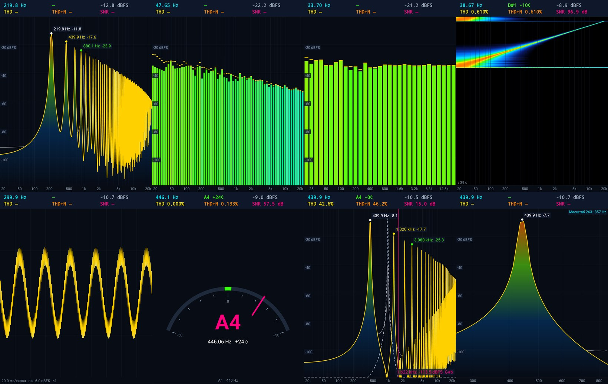

## Академія звуку (вкладка «Навчання»)

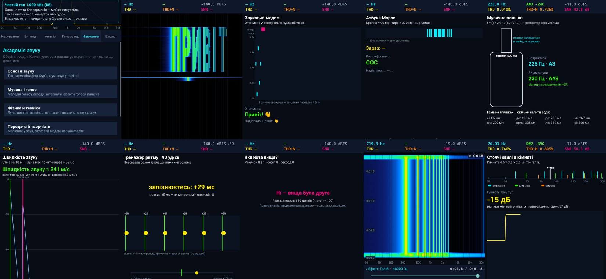

48 уроків і ігор у семи розділах. Вкладка показує спершу розділи, потім уроки розділу, а в уроці — лише
його пояснення й елементи керування, тож інтерфейс не перевантажений.

| Розділ | Уроки |
|---|---|
| **Просто про звук** | Без графіків і цифр: **завіса з ниточок** (резонанс), **на кого схожий звук** (звірі й побутові звуки), **обличчя звуку**, **пейзаж звуку**, **колір звуку**, **камінь у воді**, **м'ячик на сходах**, **повітряна кулька** |
| Основи звуку | Чистий тон · Гармоніки · **Струна, що співає** · Звук із кіл (ряд Фур'є + конструктор) · Меандр · Шум проти тону · Звук у повітрі |
| Музика і голос | Мелодія голосу · Нотне коло · **Карта голосних** (форманти F1/F2 з LPC) · **Голосовий діапазон** (клавіатура й тип голосу) · Інтервали · **Огинаюча звуку (ADSR)** · **Еквалайзер своїми руками** · Ефекти голосу · Музична пляшка |
| Фізика й техніка | Луна кімнати · Дискретизація · Стоячі хвилі · Швидкість звуку · **Фігури Хладні** · **Інтерференція двох джерел** · Ехолот |
| Слух і сприйняття | **Равлик вуха** · **Що чує вухо, а що — прилад** (криві рівної гучності ISO 226) · Межа слуху |
| Передача й творчість | Малюнок у звук · Звуковий модем · Азбука Морзе |
| Ігри | **Ритм-дуель** (1–2 телефони: мікрофон як кнопка, старт і рахунки передаються звуком) · **Папуга Кеша** · **Задуй свічки** (видих у мікрофон) · **Розбий склянку голосом** (резонанс) · **Не розбуди дракона** (тиша) · **Повтори мелодію** (4 ноти, «Саймон») · **Голосовий літачок** · **Відлуння ритму** · **Хто гучніший** · **Тепло — холодно** (два телефони) · Тренажер слуху · Тренажер ритму |

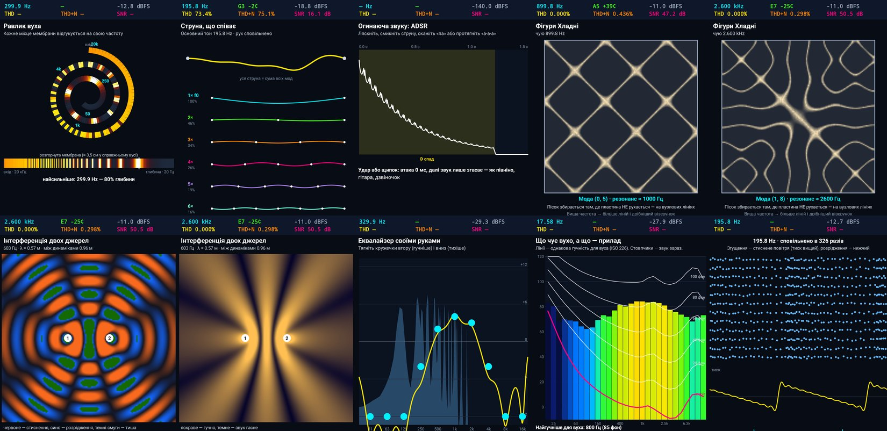

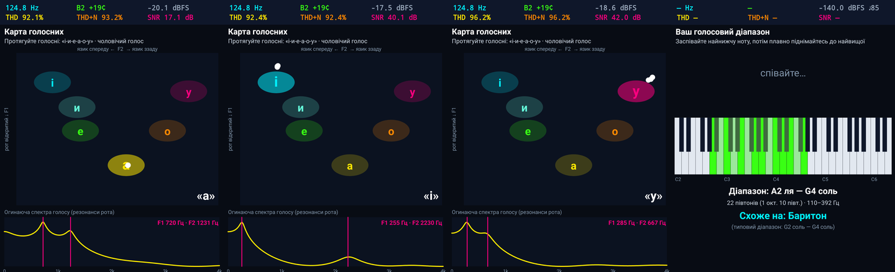

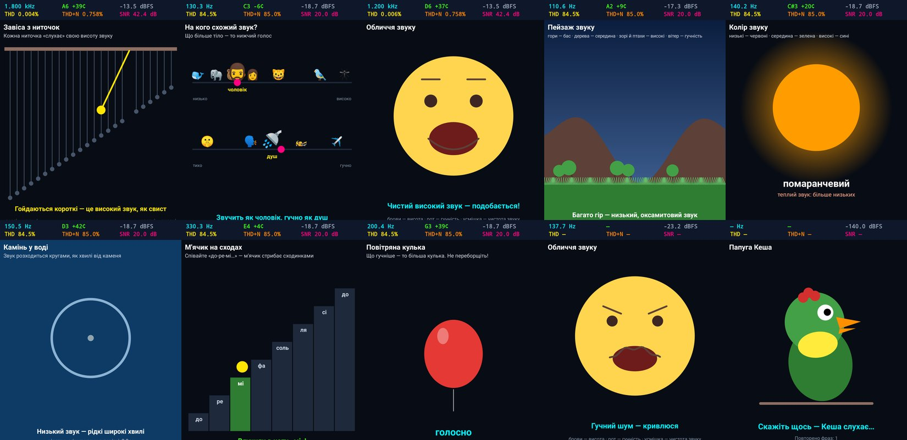

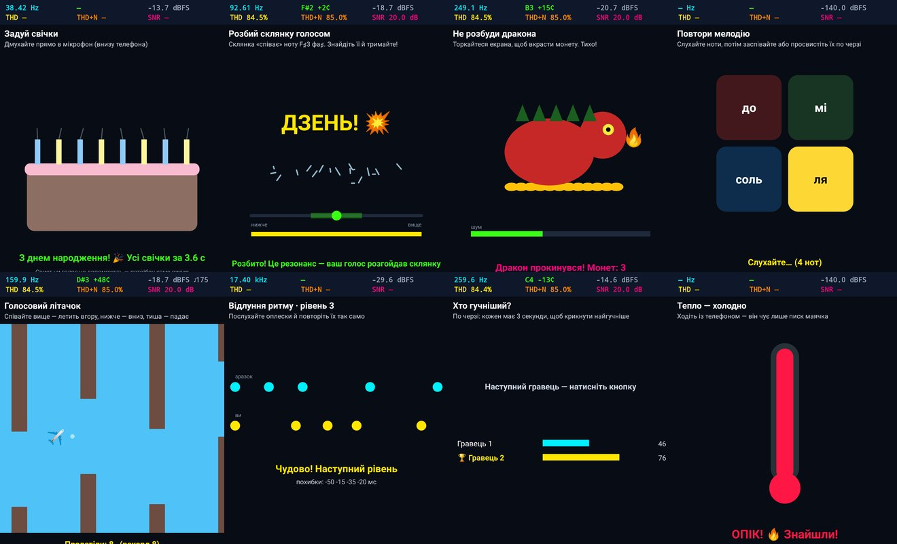

Біля кожного уроку видно, чи він слухає мікрофон: 🎙 — так, 🎹 — ні (штучний сигнал), 🎙🎹 — і те, і те.
Після виходу з уроку джерело сигналу повертається таким, яким було.

Уроки, що працюють на живому звуці, можна ввімкнути і як звичайний режим відображення (позначені 🎓):
кола Фур'є, мелодія голосу, нотне коло, звук у повітрі, луна кімнати, равлик вуха, струна, огинаюча,
фігури Хладні, криві рівної гучності, карта голосних і голосовий діапазон.

## Навчання: як «бачити» звук

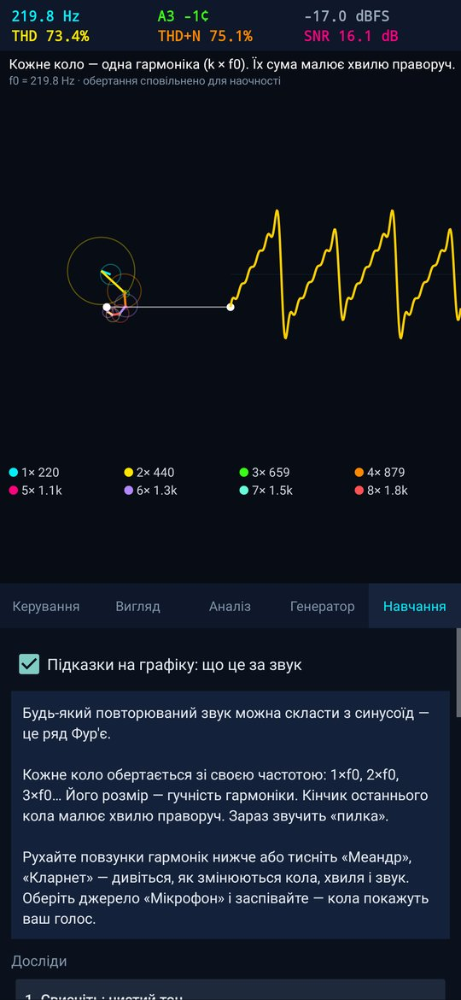 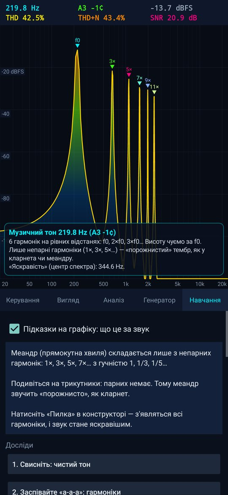

- **Підказки на графіку.** Застосунок сам визначає основну частоту, позначає гармоніки (f0, 2×, 3×…)
  і простими словами пояснює, що звучить: тиша, чистий тон, музичний тон (з описом тембру), акорд
  чи шум (глухий або яскравий).
- **Фур'є: кола.** Звук розкладається на кола, що обертаються (по одному на гармоніку); їх сума малює
  форму хвилі. Працює і з генератором, і з голосом із мікрофона.
- **Шість дослідів** на вкладці «Навчання»: свист, «а-а-а» і форманти, ряд Фур'є, меандр і непарні
  гармоніки, шум проти тону, свіп для перевірки слуху. Кожен сам налаштовує екран і пояснює, на що дивитися.
- **Конструктор гармонік:** 12 повзунків, готові тембри (синус, пилка, меандр, кларнет, орган, голос «а»),
  кнопка «Слухати».

### Лабораторія: музика і фізика звуку

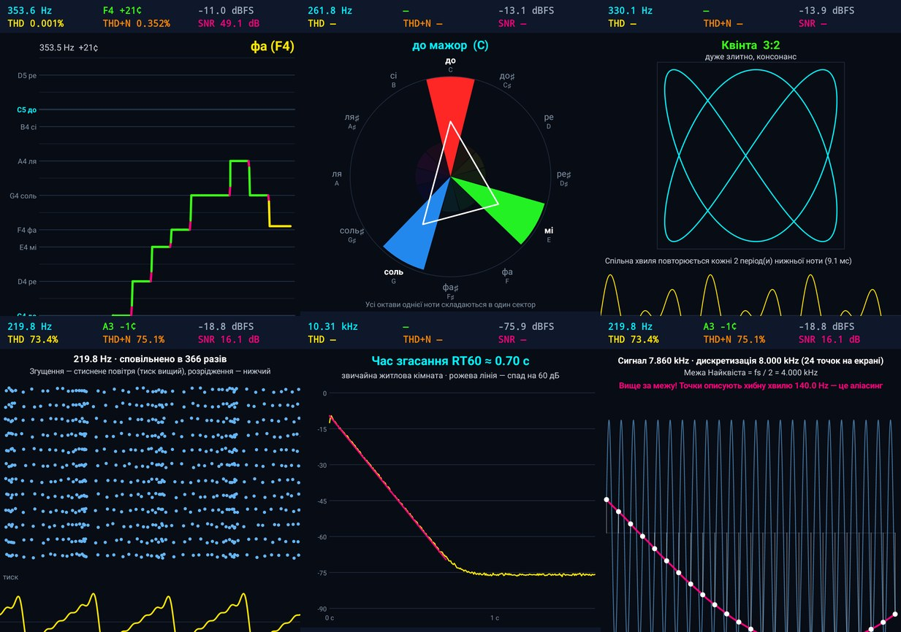

| Дослід | Що видно |
|---|---|
| Мелодія голосу | Висота голосу в часі поверх нотних ліній (до, ре, мі…); колір — наскільки точно в ноту |
| Нотне коло | Усі октави «згорнуті» в 12 нот; ноти акорду з'єднуються фігурою, підписується назва («до мажор») |
| Інтервали | Фігура Ліссажу двох нот і їх спільна хвиля: прості відношення (3:2) — консонанс, складні (16:15) — дисонанс; биття при розстроюванні |
| Звук у повітрі | Молекули, що згущуються й розріджуються, графік тиску і довжина хвилі в метрах |
| Луна кімнати | Ляск у долоні → крива згасання і час реверберації RT60 |
| Дискретизація | Вибірки, межа Найквіста і аліасинг: що «бачить» телефон, коли частота занадто висока |

## Ехолот (окрема вкладка)

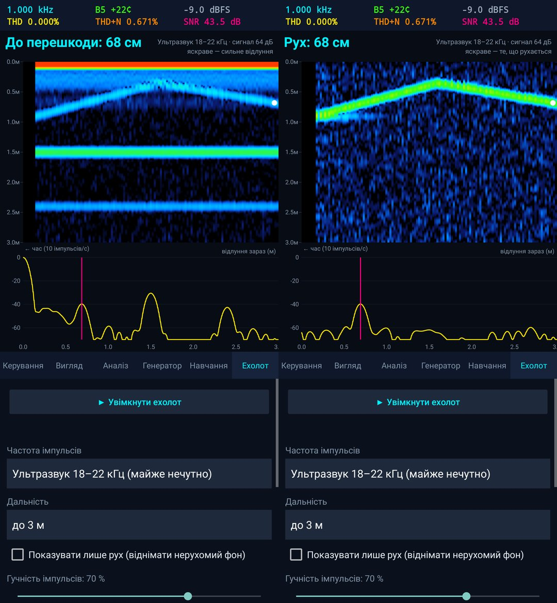

Телефон працює як сонар: динамік 10 разів на секунду посилає короткий частотний свіп (чирп), мікрофон
записує відлуння, узгоджений фільтр стискає кожне відлуння в гострий пік, а відстань = 343 м/с × затримка ÷ 2.
Відлік іде від прямого сигналу динамік → мікрофон, тому затримки самого телефона не впливають на результат.

- Діапазони: **ультразвук 18–22 кГц** (дорослі майже не чують), 14–18 кГц або чутний 2–8 кГц (найнадійніше).
- Дальність 1–10 м; «сліпа» зона ~15–20 см біля телефона.
- Історія відлунь у часі (як у рибальського ехолота), поточний профіль і відстань до найближчої перешкоди.
- Режим «лише рух» віднімає нерухомий фон: видно тільки руку чи людину, що рухається.
- На синтетичних відлуннях точність ±0,5 см до 3 м; бічні пелюстки прямого імпульсу придушені
  вікном Блекмана–Гарріса й не сприймаються як перешкода.

## Машина часу і аудіофайли

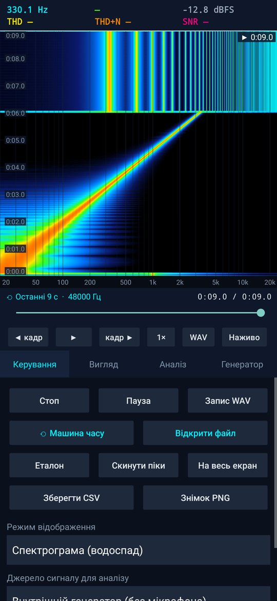 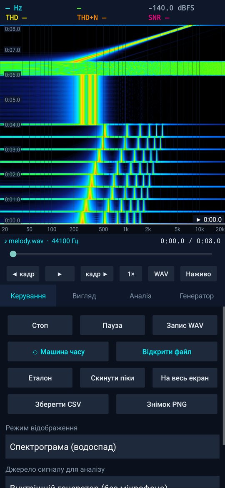

- Застосунок постійно пам'ятає **останні 2 хвилини** звуку. Кнопка «⟲ Машина часу» зупиняє
  потік і відкриває цю історію: спектрограма всього відрізка, повзунок часу, покроково кадр за кадром,
  відтворення через динамік на швидкості 1×, ½× або ¼×, збереження у WAV.
- «Відкрити файл» — те саме для будь-якого аудіофайлу: WAV (8/16/24/32-біт, float),
  MP3, M4A/AAC, OGG, Opus, FLAC, а також звук із відео (до 15 хв).
- Усі режими (спектр, RTA, осцилограф, тюнер…) показують обраний момент;
  торкання спектрограми переносить у цей момент. «Наживо» або «Назад» — повернутися до мікрофона.

## Режими

| Режим | Що показує |
|---|---|
| Спектр (лінія / стовпчики) | АЧХ у реальному часі, утримання піків, підписи трьох найбільших піків, еталонна крива |
| 1/3 октави (RTA) | 31 смуга ISO 20 Гц – 20 кГц з урахуванням еквівалентної шумової смуги вікна |
| Спектрограма | «Водоспад» зі шкалою часу; рядки не губляться, навіть якщо інтерфейс пропускає кадри |
| 3D водоспад | OpenGL ES 2.0, обертання пальцем |
| Осцилограф | Синхронізація по переходу через нуль, автопідсилення, піковий рівень |
| Тюнер | Нота, відхилення в центах, налаштовувана частота A4 (425–455 Гц) |
| 🎓 Фур'є: кола, мелодія голосу, нотне коло, звук у повітрі, луна кімнати | Навчальні візуалізації, які працюють на живому звуці — їх можна ввімкнути просто як режим відображення |

**Жести на графіку:** дотик — курсор (частота, рівень, нота); два пальці — масштаб і зсув
по частоті; подвійний дотик — скинути масштаб; довге натискання — повний екран.

## Вимірювання

- Пікова частота з параболічною інтерполяцією, THD (гармоніки 2–9), THD+N, SNR, RMS, індикатор перевантаження, BPM
- Вхід мікрофона «необроблений» (без АРП і шумозаглушення) з автоматичним відкатом на доступний
- 48 або 44,1 кГц, FFT від 1024 до 32768 точок, вікна Ганна, Хеммінга, Блекмана–Гарріса, Flat-top, прямокутне
- Згладжування, підсилення входу, калібрування в дБ (наприклад, для оцінки дБ SPL), біквадратні фільтри
- Діапазон шкали рівнів на вибір

## Генератор

Синус, меандр і пилка (з PolyBLEP, без аліасингу), трикутник, білий і рожевий шум,
логарифмічний свіп 20 Гц – 20 кГц, два тони для IMD. Сигнал можна аналізувати напряму або
**відтворювати через динамік** і вимірювати мікрофоном — так видно АЧХ динаміка чи кімнати.

## Збереження

WAV-запис → `Music/SpectrumPro`, CSV спектра → `Download/SpectrumPro`, PNG знімок → `Pictures/SpectrumPro`.
Усі налаштування запам'ятовуються.

## Збірка

Без Gradle і Android Studio — тільки пакети Ubuntu/Debian:

```sh
sudo apt-get install aapt dalvik-exchange zipalign apksigner android-sdk-platform-23 default-jdk
./build.sh
```

Скрипт створює `release.keystore` під час першої збірки (у git він не потрапляє).
Оновлення поверх встановленої версії працює лише з тим самим ключем.

## Скріншоти без пристрою

`screenshot-tests/run.sh` рендерить справжній інтерфейс застосунку на JVM через Robolectric
і зберігає PNG у `screenshot-tests/out/` — так перевіряються зміни без телефона чи емулятора.
